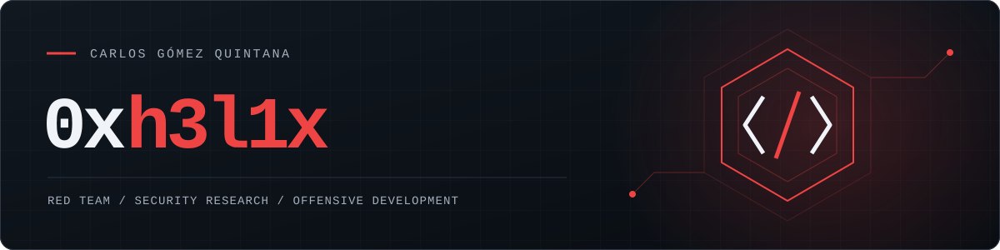

<h1 align="center">
  
</h1>

<table align="center">
<tr>
<td width="50%" align="center" valign="top">

<strong>IOActive</strong> Global Threat Group (GTG)

Senior Security Consultant <strong>Red Team Leader</strong>

</td>
<td width="50%" align="center" valign="top">

<strong>Maldev Academy</strong>

<strong>Security Researcher &amp; Developer</strong>

</td>
</tr>
</table>

  
  
  
  

  <a href="#internal-red-team-work">Internal Work</a> ·
  <a href="#vulnerability-research">CVEs</a> ·
  <a href="#publications-and-talks">Publications &amp; Talks</a> ·
  <a href="#maldev-academy">Maldev Academy</a> ·
  <a href="#tools">Tools</a>

  
  
  
  
  
  
  
  
  

---

I'm Carlos Gómez Quintana, aka `0xh3l1x`, Senior Security Consultant and Red Team Leader within IOActive's Global Threat Group (GTG). I'm also a Security Researcher and Developer at [Maldev Academy](https://github.com/Maldev-Academy). I write about what I can share at [cgomezsec.com](https://cgomezsec.com/).

### Internal Red Team Work

<table>
<tr>
<td width="50%" valign="top">

I lead technical development and build the tools we use on engagements. I also help define the team's structure and technical workflows.

</td>
<td width="50%" valign="top">

Active Directory and Microsoft Entra ID attack paths, privilege escalation, and lateral movement. OAuth device-code and consent flows, token manipulation, conditional access, and cross-tenant scenarios.

</td>
</tr>
<tr>
<td width="50%" valign="top">

CDP-driven AiTM, BotGuard behavior, Chrome Sync, and session handling. FIDO2/WebAuthn research focuses on downgrade paths in real implementations.

</td>
<td width="50%" valign="top">

Cloudflare Workers and Azure Functions / Front Door for engagement infrastructure. Request and response rewriting, client profiling, anti-bot checks, and sandbox detection.

</td>
</tr>
<tr>
<td width="50%" valign="top">

Implants in C/C++ and C#/.NET, BOFs, custom UDRLs, payload staging, DLL sideloading, and signed binary abuse. Tested against production EDR products.

</td>
<td width="50%" valign="top">

LLM-assisted code review, runtime checks, and patch validation. For <code>APT-992</code>, I'm training specialist models for offensive security with RL feedback from live security products.

</td>
</tr>
</table>

---

### Vulnerability Research

I use LLMs to review code, then test suspected bugs against real builds. My [IOActive article](https://www.ioactive.com/llm-assisted-vulnerability-research-finding-real-bugs-with-code-reasoning-models/) follows that process through two Angular findings and their fixes, from threat modeling to checking the patched versions.

| CVE | Product | Vulnerability | Contribution |
|---|---|---|---|
| [CVE-2026-68945](https://github.com/advisories/GHSA-jhpw-976m-542j) | Angular | Different request parameters could produce the same `HttpTransferCache` key, causing the wrong cached response to be reused. | Research and patch development. |
| [CVE-2026-69151](https://github.com/advisories/GHSA-jj27-h5hq-8x99) | Angular | A translation file could inject JavaScript through event-handler attributes marked for i18n. | Research and patch development. |
| [CVE-2026-105803](https://github.com/git-lfs/git-lfs/releases/tag/v3.8.1) | Git LFS | A malicious repository's `.lfsconfig` could make Git LFS run an arbitrary program as a custom transfer adapter. | Additional responsible reporter, acknowledged in the release notes. |

---

### Publications and Talks

#### Publications

<table>
<tr>
<td width="50%" valign="top">

**[LLM-Assisted Vulnerability Research: Finding Real Bugs with Code-Reasoning Models](https://www.ioactive.com/llm-assisted-vulnerability-research-finding-real-bugs-with-code-reasoning-models/)**

A workflow for turning code-review candidates into confirmed bugs, with runtime tests and patch comparisons.

</td>
<td width="50%" valign="top">

**[Authentication Downgrade Attacks: Deep Dive into MFA Bypass](https://www.ioactive.com/authentication-downgrade-attacks-deep-dive-into-mfa-bypass/)**

How weaker fallback methods let authentication flows be downgraded, even when FIDO2/WebAuthn is available.

</td>
</tr>
</table>

#### Talks

<table>
<tr>
<td width="50%" valign="top">

**Cloud Edge Phishing: Breaking the Future of Auth**

Out of the Box · Bangkok · 2025

Cloudflare Workers and Azure infrastructure for AiTM operations.

[Abstract](https://www.ioactive.com/event/out-of-the-box-carlos-gomez-quintana-cloud-edge-phishing-bangkok-thailand/)

</td>
<td width="50%" valign="top">

**Upgrading Rollback-Agnostic Replay Attacks**

Hack In The Box · Amsterdam · 2023 HACK::SOHO · 2023 ESCAR USA · Detroit

[Slides](https://conference.hitb.org/hitbsecconf2023ams/materials/D1%20COMMSEC%20-%20Upgrading%20Rollback%20Agnostic%20Replay%20Attacks%20-%20Carlos%20Gomez.pdf)

</td>
</tr>
</table>

---

### Current Research

I'm researching browser-based AiTM phishing through CDP, including BotGuard behavior and Chrome Sync. My FIDO2/WebAuthn work looks at downgrade paths and session handling in real implementations.

---

### [`Maldev Academy`](https://github.com/Maldev-Academy)

I write modules and build companion tooling for [Maldev Academy](https://github.com/Maldev-Academy) on phishing, authentication attacks, and cloud identity exploitation. Protocol internals, working implementations, OPSEC. Topics include MFA downgrade paths where weaker fallback methods remain available.

<table>
<tr>
<td>

| # | Module | Target | Technique |
|---|---|---|---|
| 01 | Microsoft Device Code Phishing | M365 | OAuth 2.0 device code flow abuse |
| 02 | GitHub Device Code Phishing | GitHub | Device code phishing against GitHub OAuth |
| 03 | Illicit Consent Grant Attack | M365 | OAuth consent phishing for persistent access |
| 04 | MFA Bypass: Invisible Proxy | M365 | AiTM proxy via Cloudflare Workers |
| 05 | Invisible Proxy: OPSEC | — | Detection evasion and infrastructure hardening |
| 06 | Evilginx Phishlet Development | M365 | Custom phishlet with MFA downgrade capabilities |
| 07 | Evilginx URL Rewriting | Evilginx | Modifying Evilginx URLs to avoid signature detection |
| 08 | GitLab Device Code Phishing | GitLab | Cloud + self-managed instance support |
| 09 | Client Analysis Via Cloudflare Workers | — | Anti-bot, anti-analysis, client fingerprinting |
| 10 | Dynamic Device Code Phishing | Microsoft | Flask app for runtime device code generation |
| 11 | MFA Bypass Via Azure AiTM | Azure AD | AiTM via Azure Functions + Azure Front Door |
| 12 | Google Phishing: BotGuard, Browser Automation, Chrome Sync | Google | BotGuard analysis, CDP browser automation, and Chrome Sync research |
| 13 | Phishing Passkeys | FIDO2/WebAuthn | Synced passkeys and hardware-key authentication flows, downgrade paths, and session capture |
| 14 | ConsentFix Attack | M365 / OAuth | ConsentFix attack chain with custom tooling for engagements |

</td>
</tr>
</table>

---

### Tools

#### Open Source

<table>
<tr>
<td width="33%" valign="top">

<b><a href="https://github.com/Maldev-Academy/GitHubDeviceCodePhishing">GitHubDeviceCodePhishing</a></b>

 

GitHub OAuth device code phishing. Minimal setup.

</td>
<td width="33%" valign="top">

<b><a href="https://github.com/Maldev-Academy/GitLabDeviceCodePhishing">GitLabDeviceCodePhishing</a></b>

 

Device code phishing for GitLab cloud and self-managed instances.

</td>
<td width="33%" valign="top">

<b><a href="https://github.com/Hexix23/shodan-mcp">shodan-mcp</a></b>

 

Shodan MCP server. Query Shodan from AI assistants.

</td>
</tr>
</table>

#### Internal Tooling — Maldev Academy

  
  
  

<i>These private tools come with the Maldev Academy modules and are available to members.</i>

<table>
<tr>
<td width="50%" valign="top">

<b>Real-time Phishing Framework</b>

  

Credential relay with live feedback. Real Chrome per target via nodriver/CDP; Google, GitHub, and Bitwarden support.

</td>
<td width="50%" valign="top">

<b>Cloudflare Workers AiTM Proxy</b>

  

Serverless reverse proxy for request/response rewriting and credential/session capture.

</td>
</tr>
<tr>
<td width="50%" valign="top">

<b>Azure AiTM Proxy</b>

  

AiTM proxy on Azure Functions and Azure Front Door.

</td>
<td width="50%" valign="top">

<b>Evilginx M365 Phishlet</b>

  

MFA downgrade paths where weaker authentication methods remain enabled.

</td>
</tr>
<tr>
<td width="50%" valign="top">

<b>Google MFA Bypass Framework</b>

  

BotGuard analysis, browser-driven authentication via nodriver/CDP, and Chrome Sync research.

</td>
<td width="50%" valign="top">

<b>Passkey Phisher</b>

  

Synced passkeys and hardware-key authentication flows, CDP virtual authenticators, downgrade paths, and session capture.

</td>
</tr>
<tr>
<td width="50%" valign="top">

<b>ConsentFix Tool</b>

  

OAuth consent abuse with the ConsentFix lure flow, packaged for engagements.

</td>
<td width="50%" valign="top">

<b>Client Fingerprinting Worker</b>

  

Client profiling on Cloudflare Workers: anti-bot checks, sandbox detection, browser fingerprinting, and geo filtering.

</td>
</tr>
</table>

---

### Stack

  

  

---

  

<code>0xh3l1x</code>

